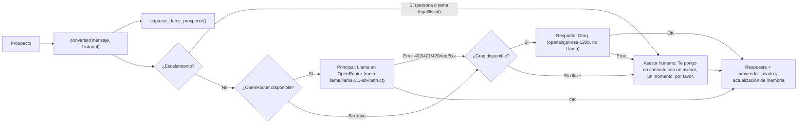

# SustentIA — Asistente Inteligente con Llama

Proyecto desarrollado para el **Hackathon 1** del curso **Inteligencia Artificial Aplicada con Llama (INFOTEC / DEVF — Módulo 1)**.

## Problema, usuario y solución

- **Problema real:** Los prospectos de la inmobiliaria **Sustentia** (Morelia, Michoacán) suelen escribir fuera de horario laboral esperando respuesta inmediata. Sin atención oportuna ni precalificación inicial, los asesores pierden oportunidades de venta.
- **Usuario claro:** El prospecto interesado en adquirir una casa, departamento o lote residencial en Morelia o su zona de influencia.
- **Solución:** Un asistente conversacional impulsado por **Llama (`meta-llama/llama-3.1-8b-instruct`)** de Meta vía **OpenRouter** como proveedor principal, con **respaldo automático en Groq (`openai/gpt-oss-120b`)** y **escalamiento a un asesor humano** si ningún modelo está disponible. Atiende en todo momento: saluda, identifica tipo de propiedad, zona y presupuesto, recomienda desarrollos reales del catálogo, responde preguntas frecuentes sobre créditos, recuerda nombre y presupuesto durante la charla, captura datos de contacto, propone agendar una visita y escala a un asesor humano cuando corresponde.

> **Transparencia sobre los proveedores y modelos:**
> - **Principal:** **OpenRouter** (`https://openrouter.ai/api/v1`) con **`meta-llama/llama-3.1-8b-instruct`** (o `meta-llama/llama-3.3-70b-instruct`), puerta de acceso a los modelos Llama de Meta con interfaz compatible con OpenAI (Groq retiró el acceso *self-serve* a sus modelos Llama de chat).
> - **Respaldo automático de continuidad:** **Groq** (`https://api.groq.com/openai/v1`) con **`openai/gpt-oss-120b`** usando el mismo SDK `openai`. Con total honestidad: **`openai/gpt-oss-120b` NO es un modelo Llama**; su función es mantener la continuidad operativa si OpenRouter falla o se agotan sus créditos (errores 402, 401, 429, red o servidor).
> - **Sin modelo disponible (asesor humano):** El asistente no funciona sin un modelo real. Si OpenRouter deja de responder y el respaldo de Groq también falla, el asistente no contesta con respuestas prefabricadas: pasa la conversación a un asesor humano. Preferí eso a que un prospecto reciba una respuesta que ningún modelo generó.

---

## Catálogo oficial configurado

El asistente responde únicamente con la información estructurada del catálogo de Sustentia (solo zonas generales, **sin direcciones exactas ni cantidades inventadas de unidades disponibles**):

| Desarrollo | Tipo | Zona | Precio | Detalles clave |
| :--- | :--- | :--- | :--- | :--- |
| **San Pedro** | Casas | Morelia, zona Walmart La Huerta | Desde $1,250,000 | 2 a 3 recámaras; entrega inmediata en algunos modelos |
| **Torres Zojo** | Departamentos | Morelia, por el Tecnológico de Morelia | Desde $1,200,000 aprox. | Departamentos ubicados por el Tecnológico de Morelia |
| **Veronesa** | Casas | Morelia, zona La Calera | Desde $2,690,000 | 3 recámaras |
| **Paseo de Andalucía (modelos Alba y Leira)** | Departamentos y casas | Morelia, zona Altozano | Desde $2,830,000 | Modelos Alba y Leira |
| **Rincón de las Aves** | Casas | Morelia, zona El Vergel | Desde $2,245,000 | Casa club y gimnasio |
| **Tepatzícuaro** | Lotes residenciales campestres | Acuitzio del Canje, a 20 min de Morelia | Desde $705,127 | Lago, trotapista y ciclovía |
| **Valle Verde** | Lotes | Morelia | $5,000 por m² | Precio por metro cuadrado |

**Créditos aceptados en general:** Infonavit, Fovissste y bancario.

---

## Arquitectura del asistente



Componentes principales (presentes tanto en [`Asistente_Inteligente_con_Llama_SustentIA.ipynb`](./Asistente_Inteligente_con_Llama_SustentIA.ipynb) como en [`asistente.py`](./asistente.py)):

1. **Cadena de proveedores (`OpenRouter (Llama) → Groq (respaldo) → asesor humano`):** Usa el SDK `openai` apuntando primero a **OpenRouter** (`https://openrouter.ai/api/v1`, `meta-llama/llama-3.1-8b-instruct`, con opción `meta-llama/llama-3.3-70b-instruct`) y, ante cualquier error (`402`, `401`, `429`, red o servidor), reintenta automáticamente el mismo turno con **Groq** (`https://api.groq.com/openai/v1`, `openai/gpt-oss-120b`, que no es Llama sino respaldo de continuidad) sin interrumpir la charla ni perder el historial. Ambas llaves (`OPENROUTER_API_KEY` y `GROQ_API_KEY`) se leen desde `google.colab.userdata`, variables de entorno o `getpass` (nunca escritas en código). Si solo existe una llave, se trabaja con ese proveedor y el otro escalón se salta; si no hay llaves configuradas o ambos proveedores fallan, marca `escalado=True`, registra `Sin modelo disponible — escalado a asesor` y devuelve `MENSAJE_ESCALAMIENTO` (handoff a un asesor humano, sin respuestas prefabricadas). Cada turno registra el proveedor efectivo en `proveedor_usado`.
2. **System prompt con catálogo inyectado:** `formatear_catalogo_para_prompt()` y `construir_system_prompt()` convierten la lista estructurada de desarrollos en el contexto oficial del modelo.
3. **Memoria de conversación:** `crear_historial()`, `agregar_mensaje()` y `recortar_historial()` mantienen el historial por turnos preservando el `system prompt` y permitiendo recordar nombre y presupuesto.
4. **Captura de datos del prospecto:** `capturar_datos_prospecto()` extrae automáticamente `nombre`, `telefono`, `tipo_propiedad`, `zona`, `presupuesto`, `credito` y `desarrollo_interes` en un diccionario estructurado.
5. **Regla de escalamiento:** `detectar_escalamiento()` identifica solicitudes de hablar con un asesor/persona o consultas legales y fiscales (ISR, escrituración, notaría, impuestos, demandas) y responde exactamente:  
   `Te pongo en contacto con un asesor, un momento, por favor.`

---

## Estrategia de prompts explicada

1. **System prompt como contrato:** Define explícitamente identidad, tono, flujo comercial por etapas y límites de operación antes de cualquier turno del usuario.
2. **Contexto del catálogo inyectado (grounding):** Al pasar los 7 desarrollos directamente desde la estructura Python hacia el prompt, existe una única fuente de verdad sin duplicar datos ni inventar propiedades.
3. **Reglas negativas anti-alucinación y privacidad:** Prohíbe explícitamente inventar unidades disponibles, dar direcciones exactas o inventar teléfonos; cualquier teléfono de asesor se sustituye por el marcador `[teléfono del asesor]`.
4. **Temperatura conservadora (`0.3`):** Reduce la creatividad innecesaria al citar precios, zonas y créditos aceptados.
5. **Defensa en profundidad para escalamiento:** La regla de escalamiento está escrita en el prompt **y** verificada en código con `detectar_escalamiento()`, garantizando que temas legales/fiscales o peticiones de atención humana nunca dependan solo de la probabilidad del modelo.
6. **Modelo por defecto vs. fidelidad al prompt (8B vs. 70B):** `meta-llama/llama-3.1-8b-instruct` es el modelo por defecto del curso, pero **`meta-llama/llama-3.3-70b-instruct`** sigue las reglas del prompt con más fidelidad (verificado en pruebas reales: el 8B llegó a inventar el nombre de un asesor y a sugerir un desarrollo fuera de presupuesto; el 70B no).
7. **Transparencia y continuidad en respaldo:** Cuando ocurre un failover hacia Groq (`openai/gpt-oss-120b`), se envía exactamente el mismo contrato `SYSTEM_PROMPT` y el historial acumulado, y se registra el proveedor en `proveedor_usado` para mantener trazabilidad en cada turno.

---

## Cómo ejecutarlo

### Opción A: Google Colab (recomendada para el curso)

1. Sube o abre [`Asistente_Inteligente_con_Llama_SustentIA.ipynb`](./Asistente_Inteligente_con_Llama_SustentIA.ipynb) en [Google Colab](https://colab.research.google.com/).
2. En el panel izquierdo de Colab, abre el ícono de **Secretos (llave)** y configura al menos una de estas llaves:
   - `OPENROUTER_API_KEY` (proveedor principal Llama, de [openrouter.ai/keys](https://openrouter.ai/keys); opcionalmente cambia `MODELO_LLAMA` a `meta-llama/llama-3.3-70b-instruct`).
   - `GROQ_API_KEY` (respaldo automático con `openai/gpt-oss-120b`, de [console.groq.com](https://console.groq.com/)).
   Si solo configuras una de las dos llaves, el asistente trabajará con ese proveedor y saltará automáticamente el otro escalón.
3. Si prefieres ingresarlas manualmente al ejecutar, omite el paso 2 y escríbelas cuando aparezca `getpass` (si dejas ambas vacías, la demo avisará que requiere una llave y no fingirá una conversación).
4. Haz clic en **Entorno de ejecución → Ejecutar todas**.
5. Revisa la celda de demostración con el proveedor activo, `proveedor_usado` por turno, la conversación completa, los datos capturados y las pruebas de escalamiento.

### Opción B: Ejecución local en Python

El script [`asistente.py`](./asistente.py) requiere el paquete `openai` y al menos una API key (`OPENROUTER_API_KEY` o `GROQ_API_KEY`) para ejecutar la demostración con un modelo real:

```bash
pip install openai
export OPENROUTER_API_KEY="tu_clave_de_openrouter"
export GROQ_API_KEY="tu_clave_de_groq_opcional"
python3 asistente.py
```

Si ejecutas `python3 asistente.py` sin ninguna llave configurada, el script imprime un aviso indicando que se necesita `OPENROUTER_API_KEY` o `GROQ_API_KEY` y termina sin fingir una demo.

---

## Ejemplo breve de conversación

Flujo esperado con un modelo activo (el teléfono `443-000-0000` es un dato ficticio de prueba):

> **Prospecto:** Hola, buenas noches, ¿hay alguien disponible para darme información?  
> **SustentIA:** ¡Hola! Bienvenido a Sustentia, tu inmobiliaria en Morelia. Con gusto te atiendo en este momento, incluso fuera de horario. ¿Buscas casa, departamento o lote, en qué zona y cuál es tu presupuesto aproximado?
>
> **Prospecto:** Busco una casa en Morelia, mi presupuesto es de $1,300,000.  
> **SustentIA:** Con tu presupuesto de $1,300,000, nuestra mejor opción es **San Pedro** (casas en Morelia, zona Walmart La Huerta, desde $1,250,000, 2 a 3 recámaras; entrega inmediata en algunos modelos)...
>
> **Prospecto:** ¡Qué bien! ¿Aceptan crédito Infonavit?  
> **SustentIA:** ¡Sí! En Sustentia aceptamos créditos Infonavit, Fovissste y bancario... ¿Me compartes por favor tu nombre y número de teléfono?
>
> **Prospecto:** Me llamo Sofía Ramírez y mi teléfono es 443-000-0000.  
> **SustentIA:** ¡Muchas gracias, Sofía Ramírez! Ya registré tu teléfono (443-000-0000)... ¿Qué día y horario te quedaría mejor para agendar una visita? Nuestro equipo confirmará tu cita por medio de `[teléfono del asesor]`.
>
> **Prospecto:** ¿Cómo se calcula el ISR y cuánto cuestan las escrituras con notario?  
> **SustentIA:** Te pongo en contacto con un asesor, un momento, por favor.

---

## Entregables del Hackathon 1 y siguiente paso (Módulo 2)

- **Notebook principal:** [`Asistente_Inteligente_con_Llama_SustentIA.ipynb`](./Asistente_Inteligente_con_Llama_SustentIA.ipynb)
- **Script modular:** [`asistente.py`](./asistente.py)
- **Documentación:** [`README.md`](./README.md)
- **Video de presentación:** Mostrar la ejecución del notebook en Google Colab explicando la estrategia de prompts, la memoria por turnos, la captura de prospectos y el escalamiento.
- **Conexión con el Módulo 2 (WhatsApp):** El núcleo desacoplado (`conversar(mensaje, historial)`) permite conectar fácilmente el asistente a un webhook de WhatsApp Business API (FastAPI + almacenamiento de sesiones por número telefónico) para atender prospectos reales en producción.
